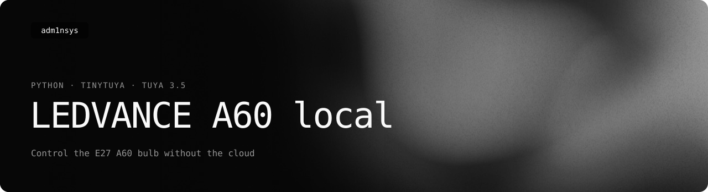

<picture>
  <source media="(prefers-color-scheme: light)" srcset=".github/readme/banner-light.svg">
  
</picture>

<p>
  <a href="https://adm1nsys.github.io/Ledvance-Smart-WiFi-E27-A60-Local-Control/"></a>
  <a href="https://github.com/adm1nsys/Ledvance-Smart-WiFi-E27-A60-Local-Control/releases/latest/download/LedvanceE27A60.py"></a>
  <a href="https://adm1nsys.github.io/Ledvance-Smart-WiFi-E27-A60-Local-Control/#versions"></a>
  <a href="https://adm1nsys.github.io/Ledvance-A60-Plugin/"></a>
  <a href="LICENSE"></a>
</p>

A command-line tool that controls the LEDVANCE Smart+ WiFi E27 A60 RGBW bulb over the local network — no cloud, no app. It talks to the bulb directly with [TinyTuya](https://github.com/jasonacox/tinytuya) using Tuya protocol 3.5.

The same script is the engine of my Homebridge plugin, [Ledvance-A60-Plugin](https://github.com/adm1nsys/Ledvance-A60-Plugin), which makes the bulb a HomeKit light.

## Requirements

- Python 3.11 or newer
- TinyTuya (tested with 1.17.2): `pip install tinytuya`
- the bulb's **device ID**, **local key** and **IP address**

The IP address shows up with `python -m tinytuya scan`, in your router or in the LEDVANCE app. The device ID and local key come from `python -m tinytuya wizard` — the [TinyTuya docs](https://github.com/jasonacox/tinytuya#setup-wizard---getting-local-keys) explain the Tuya developer account it needs.

## Usage

```
python LedvanceE27A60.py DEV_ID IP LOCAL_KEY [options]
```

| Option | What it does | Tuya data point |
|---|---|---|
| `--on` / `--off` | switch the bulb on or off | 20 |
| `--status` | print the current state once | — |
| `--tail [SEC]` | print the state every SEC seconds (default 1) until Ctrl+C | — |
| `--brightness 1-100` | brightness in white mode | 22 |
| `--shade KELVIN` | colour temperature; the bulb covers about 2700–6500 K | 23 |
| `--rgb R,G,B` | colour, 0–255 each | 24 |
| `--saturation 1-100` | saturation for `--rgb` (default 100) | 24 |
| `--raw HHHHSSSSVVVV` | colour as a 12-digit hex HSV string | 24 |
| `--debug` | verbose TinyTuya log | — |

Options can be combined. Examples (made-up ID and key):

```bash
python LedvanceE27A60.py a1b2c3d4e5f6g7h8ijklmn 192.168.0.238 'WQ!zYx8#kLp3vBn@' --on --brightness 60 --shade 3000
python LedvanceE27A60.py a1b2c3d4e5f6g7h8ijklmn 192.168.0.238 'WQ!zYx8#kLp3vBn@' --rgb 255,80,0
python LedvanceE27A60.py a1b2c3d4e5f6g7h8ijklmn 192.168.0.238 'WQ!zYx8#kLp3vBn@' --tail
```

## Tested on

[LEDVANCE SMART+ WIFI CLASSIC 60, 9 W, 2700–6500 K, E27](https://www.ledvance.com/en-int/home-lighting/products/smart-home/smart-lamps/smart-wifi/smart-classic-heatsink-lamps-with-wifi-technology/classic-bulb-shape-with-wifi-technology-c6443?productId=83025), firmware: main module V1.5.32, MCU module V1.5.32, RN bundle V1.3.0 — in 2025, on my own bulb. Other Tuya-based LEDVANCE bulbs probably use the same data points, but I have not checked.

## License

MIT. Not affiliated with LEDVANCE or Tuya.
